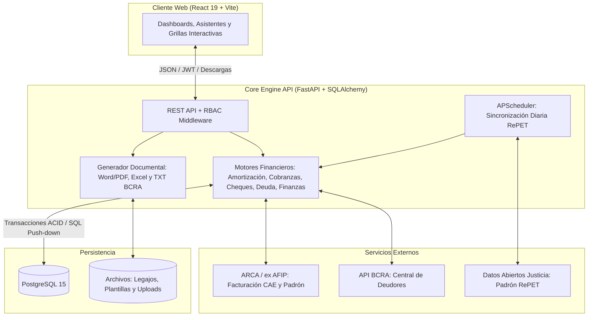

# 💳 Credit Manager - Core Engine

Plataforma financiera integral para la administración de **carteras de créditos**, **custodia y descuento de cheques**, **fondeo con inversores privados** y **tesorería corporativa**, desarrollada en Python (FastAPI) y React.

> 🌐 *Read this document in English: [README_en.md](README_en.md)*  
> 📖 *Manual de Usuario completo disponible en: [`docs/instructivo/Instructivo.pdf`](docs/instructivo/Instructivo.pdf)*

---

## 🚀 Características Principales

### 1. Cartera de Créditos y Originación
* **Motor de Amortización Financiera**: Cálculo preciso de cronogramas bajo el Sistema Francés utilizando `numpy-financial`, con soporte para períodos de gracia, forzado de fechas de vencimiento y desglose dinámico de capital, interés, IVA, gastos de otorgamiento, sellados provinciales y tasas (TNA, TEA, TEM, CFT).
* **Originación Asistida y Renovaciones**: Flujo guiado de otorgamiento con validación de políticas crediticias por socio originador, cálculo automático de capacidad de pago mediante **Perfil Transaccional** (Sueldo Computable y Cuota Afectable Máxima), gestión de legajos digitales, registro de transferencias de desembolso y refinanciación/renovación de créditos vigentes.
* **Cobranzas Individuales y Masivas Atómicas**:
  * Imputación en cascada (*primero la cuota más antigua; orden interno: IVA → Interés → Capital*).
  * Soporte para pagos parciales, cobros ordinarios y **cancelaciones anticipadas** (descontando intereses futuros no devengados).
  * Procesamiento masivo desde planillas de Excel con control transaccional ACID, reversión segura de lotes completos y **auto-ajuste de diferencias de redondeo** ($\le \$0.05$) mediante eventos de sesión de SQLAlchemy.
  * **Gestión de Punitorios**: Generación automática de créditos independientes de tipo punitorio a partir de excedentes o recargos moratorios en una única operación atómica.
* **Operaciones y Liquidaciones de Cartera**: Compra, venta (cesión) y recompra de carteras con o sin recurso, cotización financiera mediante **Valor Actual (VA)** descontado, exportación de anexos y liquidación periódica de cobranzas a socios compradores.
* **Facturación Electrónica (ARCA / ex AFIP)**: Integración directa con los servicios web de ARCA (`afip.py`) para la emisión automática de comprobantes electrónicos con CAE sobre los intereses cobrados, descarga del **Libro IVA Ventas** en Excel y lotes de facturas en PDF/ZIP.
* **Papelería Legal Automática**: Motor de generación documental basado en plantillas Word (`.docx`) con reemplazo dinámico de variables (`docxtpl`), conversión de importes a letras y compilación automática a PDF unificado listo para firmar.

### 2. Cumplimiento Normativo y Evaluación de Riesgo (BCRA, UIF y RePET)
* **Central de Deudores del BCRA**: Consulta en línea de la situación crediticia e historial de cheques rechazados por CUIT/CUIL, y generación del **Régimen Informativo para Proveedores No Financieros de Crédito (PNFC)** exportando los archivos oficiales (`PROVEEDORES.TXT`, `IMPORTES.TXT` y `TASA.TXT`) con formato de ancho fijo validado.
* **Prevención de Lavado de Activos (UIF - PLA/FT)**: Matriz parametrizable de factores y multiplicadores de riesgo crediticio, alerta de países GAFI y reportes de auditoría UIF.
* **Cruce Automatizado con RePET**: Tarea programada en segundo plano (`APScheduler`) que sincroniza diariamente el Registro Público de Personas y Entidades vinculadas a actos de Terrorismo y su Financiamiento, dejando constancia auditable en cada ficha de cliente.

### 3. Cartera de Cheques (Físicos y E-Cheqs)
* **Custodia y Operatoria de Valores**: Administración de cheques propios y de terceros, con padrón de emisores/operadores calificados crediticiamente.
* **Liquidación de Compra y Venta**: Cálculo en tiempo real de descuentos financieros por compra o negociación de cheques (días corridos, días de clearing/castigo, TNA de descuento, gastos administrativos e IVA) y adjunto de respaldos digitales.
* **Conciliación Bancaria de Valores**: Vinculación directa del cobro (acreditación) o pago (débito) de cheques contra los movimientos reales importados en las cuentas bancarias.

### 4. Inversores y Deuda Privada
* **Cuentas Comitentes y Titularidad**: Gestión del padrón de inversores (con validación de CUIT ante ARCA) y cuentas comitentes bajo régimen de **Orden Indistinta** o **Orden Conjunta**.
* **Series de Deuda y Devengamiento Diario**: Emisión de series de deuda pactadas a plazo y tasa fija, cálculo automático de intereses devengados y a devengar a cualquier fecha de corte, registro de suscripciones, rescates, retiro de intereses, renovaciones (con retiro o capitalización de intereses) y liquidación de comisiones a captadores.

### 5. Finanzas, Tesorería e Impuestos
* **Bancos, Cuentas y Conciliación de Extractos**: Panel de liquidez (saldos disponibles, Fondos Comunes de Inversión y Plazos Fijos) e importación inteligente de extractos bancarios (Banco BICA, Santander, La Pampa, etc.) con clasificación masiva de conceptos.
* **Comprobantes y Cuentas a Pagar**: Registro de facturas de proveedores con desglose impositivo completo, planes de pago en cuotas y cancelación mediante transferencias o cheques en cartera.
* **Liquidación de Comisiones Comerciales**: Cálculo mensual automatizado de comisiones de colocación, cobranza y captación de inversores, con deducción automática de anticipos vigentes.
* **Posiciones Fiscales (IVA e IIBB)**: Determinación mensual de la **Posición Neta de IVA** (débito fiscal de cuotas vs. crédito fiscal de comprobantes, retenciones, percepciones y VEPs) y **Posición de Ingresos Brutos (IIBB)** distribuida por jurisdicción provincial bajo el régimen de Convenio Multilateral.

### 6. Seguridad, Auditoría y Configuración Multi-Tenant
* **Control de Acceso Basado en Roles (RBAC)**: Autenticación mediante tokens JWT con 7 perfiles operativos (*Administrador, Gerente, Oficial de Crédito, Operador de Cobranzas, Operador de Inversiones, Responsable de Finanzas, Auditor / Solo Lectura*).
* **Trazabilidad y Auditoría Inmutable**: Bitácora de seguridad por usuario e historial auditable de transiciones de estado para créditos y clientes (`HistorialEstadoCredito`, `HistorialEstadoCliente`).
* **Autonomía Paramétrica y Feature Toggling**: 18 tablas auxiliares editables en caliente, interruptores para activar o desactivar módulos según el modelo de negocio de la empresa y sincronización bidireccional automática entre la base de datos y el archivo `.env`.

---

## 📐 Arquitectura del Sistema



---

## 🛠️ Tecnologías Utilizadas

* **Backend**: Python 3.11+ / 3.14, FastAPI, Uvicorn & Gunicorn
* **Base de Datos y ORM**: PostgreSQL 15 & SQLAlchemy 2.0 (`pg8000` / `psycopg`)
* **Procesamiento Financiero y Datos**: Pandas, NumPy, NumPy-Financial, OpenPyXL, xlrd
* **Seguridad y Configuración**: Pydantic v2, Pydantic-Settings, Passlib (`bcrypt`), Python-JOSE (JWT)
* **Integraciones y Tareas Programadas**: `afip.py` (ARCA/AFIP), HTTPX, `curl_cffi`, APScheduler, RapidFuzz
* **Motor Documental y Reportes**: `docxtpl`, `python-docx`, LibreOffice / `docx2pdf`, `pypdf`, `reportlab`, `num2words`
* **Frontend**: React 19, Vite 8, Zustand, TanStack React Query, React Router v7, Recharts, SheetJS (`xlsx`), jsPDF + html2canvas, SweetAlert2, Lucide React
* **Testing y Contenedores**: Pytest, Docker & Docker Compose, Nginx

---

## 📁 Estructura del Proyecto

```text
Credit_Manager/
├── .env.example              # Plantilla de variables de entorno y configuración multi-instancia
├── Dockerfile.backend        # Imagen de producción del backend (Python + LibreOffice + Gunicorn)
├── docker-compose.yml        # Orquestación de servicios (PostgreSQL, Backend, Frontend Nginx)
├── docker-compose.dev.yml    # Overrides para desarrollo con hot-reload y volúmenes montados
├── requirements.txt          # Dependencias de Python
├── data/                     # Almacenamiento local de archivos subidos, legajos y plantillas
├── data_imports/             # Scripts de migración e ingesta inicial de datos históricos (ETL)
├── docs/
│   └── instructivo/          # Manual de Usuario oficial en formato LaTeX (.tex) y PDF
├── frontend/                 # Aplicación web SPA (React 19 + Vite) -> ver frontend/README.md
├── notebooks/                # Notebooks Jupyter para pruebas interactivas, auditoría y migración
├── scripts/
│   ├── reset_and_seed_db.py          # Reseteo completo del esquema PostgreSQL y carga de semillas
│   └── backfill_historial_estados.py # Inicialización de bitácoras de auditoría de estados
├── src/
│   ├── config.py             # Configuración centralizada (CompanyConfig, APIConfig, DatabaseConfig)
│   ├── api/                  # Servidor FastAPI, middlewares, esquemas Pydantic y rutas
│   │   ├── main.py           # Punto de entrada de la API, lifespan y registro de routers
│   │   ├── scheduler.py      # Cron jobs en segundo plano (sincronización diaria RePET)
│   │   ├── dependencies/     # Dependencias de autenticación JWT y validación RBAC
│   │   ├── routes/           # 20 routers modulares (creditos, cobranzas, cheques, inversores, etc.)
│   │   └── schemas/          # Contratos de entrada/salida validados con Pydantic
│   ├── database/             # Capa de persistencia relacional
│   │   ├── connection.py     # Motor SQLAlchemy y fábrica de sesiones PostgreSQL
│   │   ├── events.py         # Listeners de sesión (auto-ajuste de redondeos en cobranzas)
│   │   ├── seed_*.py         # Seeders automáticos (admin, bancos, conceptos, provincias, módulos)
│   │   └── models/           # Modelos ORM organizados por dominio (creditos, cheques, deuda, finance)
│   ├── logic/                # Reglas de negocio y motores de cálculo
│   │   ├── creditos/         # Amortización, originación, cobranzas, facturación, legajos, parsers bancarios
│   │   ├── cheques/          # Operatoria y descuento de cheques
│   │   ├── deuda/            # Series de deuda, cuentas comitentes, devengamiento, suscripciones y comisiones
│   │   ├── refinanciacion/   # Fusión y renovación de créditos
│   │   └── uif/              # Matriz de riesgo PLA/FT, perfil transaccional y reportes UIF
│   ├── portfolio/            # Compra, venta (cesión) y recompra de carteras de créditos
│   ├── reports/              # Reportes analíticos de saldos, régimen BCRA y reportes financieros
│   ├── services/             # Clientes de servicios externos (ARCA/AFIP, BCRA, RePET, auditoría)
│   └── utils/                # Utilidades transversales de fechas y manejo de archivos
└── tests/                    # Suite de pruebas unitarias y de integración con Pytest
```

---

## ⚙️ Instalación y Configuración

### 1. Clonar el repositorio
```bash
git clone https://github.com/JuanMCarini/Credit_Manager.git
cd Credit_Manager
```

### 2. Configurar Variables de Entorno (`.env`)
Copia el archivo de plantilla `.env.example` a `.env` en la raíz del proyecto y ajusta los parámetros de tu organización y base de datos PostgreSQL:
```bash
cp .env.example .env
```
Variables principales del archivo `.env`:
```env
# Orígenes permitidos por CORS
API_ALLOWED_ORIGINS=["http://localhost:5173","http://127.0.0.1:5173"]

# Datos de la Empresa Administradora (sincronizados bidireccionalmente con la BD)
COMPANY_RAZON_SOCIAL="Empresa Ficticia S.A."
COMPANY_CUIT=30000000000
COMPANY_DOMICILIO="Calle Falsa 123, Ciudad, Provincia"
COMPANY_EMAIL_CONTACTO="contacto@empresaficticia.com"
COMPANY_TELEFONO="+54 9 11 0000-0000"
COMPANY_BANK_ACCOUNT="CC $ 12345678"
COMPANY_BANK_NAME="Banco Ficticio"
COMPANY_CBU="0000000000000000000000"
COMPANY_DIA_CORTE=28

# Conexión a Base de Datos PostgreSQL
DB_USER=postgres
DB_PASSWORD=postgres
DB_HOST=localhost
DB_PORT=5432
DB_NAME=credit_manager
```

### 3. Opción A: Despliegue con Docker Compose (Recomendado)
Para levantar la base de datos PostgreSQL, el backend y el frontend en contenedores:

```bash
# Modo Desarrollo (con hot-reload en backend y frontend)
docker-compose -f docker-compose.yml -f docker-compose.dev.yml up -d --build

# Modo Producción (Backend con Gunicorn + Frontend servido por Nginx)
docker-compose up -d --build
```

#### 🏗️ Ejecución de múltiples instancias (Multi-Tenant)
La arquitectura de Docker está parametrizada para correr múltiples instancias independientes en el mismo servidor o estación de trabajo:
1. Copia el proyecto en otro directorio.
2. Edita el archivo `.env` de la nueva instancia asignando un nombre de proyecto y puertos libres:
   ```env
   COMPOSE_PROJECT_NAME=credit_manager_empresa2
   HOST_PORT_DB=5434
   HOST_PORT_BACKEND=8001
   HOST_PORT_FRONTEND=81
   HOST_PORT_FRONTEND_DEV=5174
   ```
3. Incluye el nuevo puerto del frontend en `API_ALLOWED_ORIGINS`:
   ```env
   API_ALLOWED_ORIGINS=["http://localhost:5174","http://127.0.0.1:5174","http://localhost:81"]
   ```
4. Inicia los contenedores con `docker-compose`. Cada instancia contará con su propio volumen de PostgreSQL completamente aislado.

### 4. Opción B: Instalación Local (Entorno Virtual Python + Node.js)

1. **Crear y activar el entorno virtual de Python**:
   ```bash
   # En Windows (PowerShell)
   python -m venv venv
   .\venv\Scripts\Activate.ps1

   # En Linux / macOS
   python3 -m venv venv
   source venv/bin/activate
   ```
2. **Instalar dependencias del backend**:
   ```bash
   pip install -r requirements.txt
   ```
3. **Inicializar o resetear la base de datos PostgreSQL**:
   Al iniciar la aplicación por primera vez, FastAPI crea automáticamente las tablas y ejecuta los *seeders* iniciales (roles, usuario administrador, empresa principal, provincias, bancos, conceptos y módulos). Si deseas limpiar y reinicializar la base de datos desde cero:
   ```bash
   python scripts/reset_and_seed_db.py
   ```
   > 🔑 **Credenciales por defecto del Administrador**:  
   > **Usuario**: `admin@creditmanager.com` | **Contraseña**: `123456`

---

## 🚀 Uso y Ejecución

### Levantar el Backend (FastAPI)
```bash
uvicorn src.api.main:app --reload
```
Documentación interactiva de la API disponible en:
* **Swagger UI**: `http://127.0.0.1:8000/docs`
* **ReDoc**: `http://127.0.0.1:8000/redoc`

### Levantar el Frontend (React + Vite)
En otra terminal, accede a la carpeta `frontend` (ver más detalles en [`frontend/README.md`](frontend/README.md)):
```bash
cd frontend
npm install
npm run dev
```
La interfaz web estará disponible en `http://localhost:5173`.

### Ejecutar la Suite de Pruebas (Pytest)
Para correr los tests unitarios y de integración (amortización, cobranzas, validaciones, renovaciones, eventos de redondeo y auditoría de estados):
```bash
pytest
```
*(Nota: Las pruebas utilizan una base de datos aislada en memoria para garantizar rapidez y no afectar tus datos de desarrollo).*
