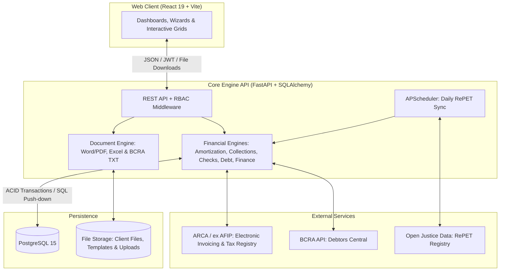

# 💳 Credit Manager - Core Engine

A comprehensive financial platform for managing **credit portfolios**, **check and E-Cheq custody & discounting**, **private investor funding**, and **corporate treasury & tax compliance**, built with Python (FastAPI) and React.

> 🌐 *Leer este documento en Español: [README.md](README.md)*  
> 📖 *Complete User Manual (Spanish) available at: [`docs/instructivo/Instructivo.pdf`](docs/instructivo/Instructivo.pdf)*

---

## 🚀 Main Features

### 1. Credit Portfolio & Origination
* **Financial Amortization Engine**: Precise installment schedule calculation under the French System using `numpy-financial`, supporting grace periods, enforced due dates, and dynamic breakdown of principal, interest, VAT, origination fees, provincial stamp taxes, and financial rates (TNA, TEA, TEM, CFT).
* **Assisted Origination & Renewals**: Guided loan origination workflow with partner-specific credit policy validation, automatic payment capacity calculation via **Transactional Profiles** (Computable Salary and Maximum Affectable Installment), digital client files (*legajos*), disbursement transfer tracking, and loan refinancing/renewal.
* **Atomic Individual & Bulk Collections**:
  * Waterfall payment allocation (*oldest unpaid installment first; internal order: VAT → Interest → Principal*).
  * Support for partial payments, regular installments, and **early payoffs** (automatically discounting unearned future interest).
  * Bulk processing from Excel spreadsheets with full ACID transactional control, safe batch rollback/reversal, and **automatic rounding adjustment** ($\le \$0.05$) powered by SQLAlchemy session event listeners.
  * **Penalties Management**: Automatic generation of independent penalty credits from client overpayments or late surcharges within a single atomic transaction.
* **Portfolio Operations & Settlements**: Purchase, sale (assignment), and repurchase of credit portfolios with or without recourse, financial valuation via discounted **Present Value (PV)**, annex exports, and periodic collection settlements for purchasing partners.
* **Electronic Invoicing (ARCA / ex AFIP)**: Direct integration with ARCA web services (`afip.py`) for automatic issuance of electronic invoices with official authorization codes (CAE) on collected interest, **VAT Sales Ledger (Libro IVA Ventas)** Excel exports, and batch PDF/ZIP invoice downloads.
* **Automated Legal Stationery**: Document generation engine based on Word templates (`.docx`) with dynamic placeholder replacement (`docxtpl`), automatic number-to-words conversion, and instant compilation into a unified PDF ready for signature.

### 2. Regulatory Compliance & Risk Assessment (BCRA, UIF & RePET)
* **BCRA Debtors Central**: Real-time online queries of credit status and bounced check history by Tax ID (CUIT/CUIL), plus generation of the **BCRA Reporting Regime for Non-Financial Credit Providers (PNFC)** exporting official fixed-width text files (`PROVEEDORES.TXT`, `IMPORTES.TXT`, and `TASA.TXT`).
* **Anti-Money Laundering (UIF - AML/CFT)**: Configurable risk scoring matrix (risk factors and multipliers), FATF/GAFI high-risk country alerts, and UIF audit reports.
* **Automated RePET Screening**: Background scheduled task (`APScheduler`) that synchronizes daily with the Public Registry of Persons and Entities Linked to Acts of Terrorism and its Financing (RePET), maintaining an auditable timestamped record on every client profile.

### 3. Check & E-Cheq Portfolio
* **Custody & Operations**: Full lifecycle management of own and third-party checks (physical checks and electronic E-Cheqs), including a credit-rated registry of issuers and operators.
* **Purchase & Discount Settlements**: Real-time financial discount calculation when buying or selling checks (calendar days, clearing/penalty days, discount TNA, administrative fees, and VAT) with digital attachment storage.
* **Bank Statement Reconciliation**: Direct two-click linking of check deposits (credits) or payments (debits) against imported bank account transactions.

### 4. Investors & Private Debt
* **Custody Accounts & Ownership Regimes**: Investor registry management (with automated CUIT verification against ARCA) and custody accounts (*Cuentas Comitentes*) supporting **Joint** (*Conjunta*) or **Indistinct/Individual** (*Indistinta*) ownership regimes.
* **Debt Series & Daily Accrual**: Issuance of fixed-rate and fixed-term private debt series, automatic calculation of accrued and future interest at any cutoff date, subscriptions, redemptions, interest withdrawals, maturities/renewals (with interest withdrawal or capitalization), and broker commission settlements.

### 5. Finance, Treasury & Taxes
* **Banks, Accounts & Statement Reconciliation**: Treasury liquidity dashboard (available cash, Money Market Mutual Funds / FCI, and Fixed-Term Deposits) and automated bank statement parsers (Banco BICA, Santander, La Pampa, etc.) with bulk concept classification.
* **Vouchers & Accounts Payable**: Supplier registry, purchase invoice management with full tax breakdown, installment payment plans, and settlement via bank transfers or portfolio checks.
* **Commercial Commission Settlements**: Automated monthly calculation of origination, collection, and investor brokerage commissions, automatically deducting active cash advances.
* **Tax Positions (VAT & Gross Receipts / IIBB)**: Monthly calculation of the **Net VAT Position** (collected interest VAT debit vs. purchase VAT credit, bank withholdings, perceptions, and VEP payments) and **Gross Receipts Tax (IIBB)** distributed across provincial jurisdictions under the Multilateral Agreement (*Convenio Multilateral*).

### 6. Security, Auditing & Multi-Tenant Configuration
* **Role-Based Access Control (RBAC)**: JWT authentication with 7 operational roles (*Administrator, Manager, Credit Officer, Collections Operator, Investment Operator, Finance Manager, Auditor / Read-Only*).
* **Traceability & Immutable Audit Logs**: User security audit trail and immutable state transition history for both credits and clients (`HistorialEstadoCredito`, `HistorialEstadoCliente`).
* **Parametric Autonomy & Feature Toggling**: 18 hot-editable auxiliary tables, dynamic module toggles to enable/disable system areas per business model, and bidirectional hot-synchronization between the database and the `.env` file.

---

## 📐 System Architecture



---

## 🛠️ Technologies Used

* **Backend**: Python 3.11+ / 3.14, FastAPI, Uvicorn & Gunicorn
* **Database & ORM**: PostgreSQL 15 & SQLAlchemy 2.0 (`pg8000` / `psycopg`)
* **Financial Processing & Data**: Pandas, NumPy, NumPy-Financial, OpenPyXL, xlrd
* **Security & Configuration**: Pydantic v2, Pydantic-Settings, Passlib (`bcrypt`), Python-JOSE (JWT)
* **Integrations & Background Jobs**: `afip.py` (ARCA/AFIP), HTTPX, `curl_cffi`, APScheduler, RapidFuzz
* **Document & Report Generation**: `docxtpl`, `python-docx`, LibreOffice / `docx2pdf`, `pypdf`, `reportlab`, `num2words`
* **Frontend**: React 19, Vite 8, Zustand, TanStack React Query, React Router v7, Recharts, SheetJS (`xlsx`), jsPDF + html2canvas, SweetAlert2, Lucide React
* **Testing & Containers**: Pytest, Docker & Docker Compose, Nginx

---

## 📁 Project Structure

```text
Credit_Manager/
├── .env.example              # Environment variable template and multi-instance settings
├── Dockerfile.backend        # Backend production image (Python + LibreOffice + Gunicorn)
├── docker-compose.yml        # Services orchestration (PostgreSQL, Backend, Frontend Nginx)
├── docker-compose.dev.yml    # Development overrides with hot-reload and mounted volumes
├── requirements.txt          # Python dependencies
├── data/                     # Local storage for uploaded files, digital legajos, and templates
├── data_imports/             # Migration and initial historical data ingestion scripts (ETL)
├── docs/
│   └── instructivo/          # Official User Manual in LaTeX (.tex) and PDF formats
├── frontend/                 # Web SPA client (React 19 + Vite) -> see frontend/README_en.md
├── notebooks/                # Jupyter Notebooks for interactive testing, auditing, and migration
├── scripts/
│   ├── reset_and_seed_db.py          # Full PostgreSQL schema reset and initial data seeding
│   └── backfill_historial_estados.py # State audit log initialization and backfilling
├── src/
│   ├── config.py             # Centralized configuration (CompanyConfig, APIConfig, DatabaseConfig)
│   ├── api/                  # FastAPI server, middlewares, Pydantic schemas, and routes
│   │   ├── main.py           # API entry point, lifespan hooks, and router registration
│   │   ├── scheduler.py      # Background cron jobs (daily RePET synchronization)
│   │   ├── dependencies/     # JWT authentication and RBAC enforcement dependencies
│   │   ├── routes/           # 20 modular routers (creditos, cobranzas, cheques, inversores, etc.)
│   │   └── schemas/          # Pydantic request/response validation schemas
│   ├── database/             # Relational persistence layer
│   │   ├── connection.py     # SQLAlchemy engine and PostgreSQL session factory
│   │   ├── events.py         # Session listeners (automatic collection rounding adjustments)
│   │   ├── seed_*.py         # Automated seeders (admin, banks, concepts, provinces, modules)
│   │   └── models/           # Domain-organized ORM models (creditos, cheques, deuda, finance)
│   ├── logic/                # Business rules and calculation engines
│   │   ├── creditos/         # Amortization, origination, collections, invoicing, legajos, bank parsers
│   │   ├── cheques/          # Check operations and discounting engine
│   │   ├── deuda/            # Debt series, custody accounts, daily accrual, subscriptions & commissions
│   │   ├── refinanciacion/   # Credit merging and renewal logic
│   │   └── uif/              # AML/CFT risk matrix, transactional profiles, and UIF reports
│   ├── portfolio/            # Purchase, sale (assignment), and repurchase of credit portfolios
│   ├── reports/              # Analytical balance reports, BCRA regime, and financial reports
│   ├── services/             # External service clients (ARCA/AFIP, BCRA, RePET, state auditing)
│   └── utils/                # Cross-cutting date and file handling utilities
└── tests/                    # Unit and integration test suite with Pytest
```

---

## ⚙️ Installation and Setup

### 1. Clone the repository
```bash
git clone https://github.com/JuanMCarini/Credit_Manager.git
cd Credit_Manager
```

### 2. Configure Environment Variables (`.env`)
Copy the `.env.example` template to `.env` in the project root and adjust the parameters for your company and PostgreSQL database:
```bash
cp .env.example .env
```
Key variables in `.env`:
```env
# Allowed CORS origins
API_ALLOWED_ORIGINS=["http://localhost:5173","http://127.0.0.1:5173"]

# Administrative Company Data (bidirectionally synced with the DB)
COMPANY_RAZON_SOCIAL="Empresa Ficticia S.A."
COMPANY_CUIT=30000000000
COMPANY_DOMICILIO="Calle Falsa 123, Ciudad, Provincia"
COMPANY_EMAIL_CONTACTO="contacto@empresaficticia.com"
COMPANY_TELEFONO="+54 9 11 0000-0000"
COMPANY_BANK_ACCOUNT="CC $ 12345678"
COMPANY_BANK_NAME="Banco Ficticio"
COMPANY_CBU="0000000000000000000000"
COMPANY_DIA_CORTE=28

# PostgreSQL Database Connection
DB_USER=postgres
DB_PASSWORD=postgres
DB_HOST=localhost
DB_PORT=5432
DB_NAME=credit_manager
```

### 3. Option A: Deployment with Docker Compose (Recommended)
To spin up the PostgreSQL database, backend, and frontend containers:

```bash
# Development Mode (with hot-reload on backend and frontend)
docker-compose -f docker-compose.yml -f docker-compose.dev.yml up -d --build

# Production Mode (Backend with Gunicorn + Frontend served by Nginx)
docker-compose up -d --build
```

#### 🏗️ Running Multiple Instances (Multi-Tenant)
The Docker deployment architecture is parameterized so you can run multiple independent instances on the same host:
1. Copy/clone the project into a new folder.
2. Edit the `.env` file of the new instance with a unique project name and unused host ports:
   ```env
   COMPOSE_PROJECT_NAME=credit_manager_company2
   HOST_PORT_DB=5434
   HOST_PORT_BACKEND=8001
   HOST_PORT_FRONTEND=81
   HOST_PORT_FRONTEND_DEV=5174
   ```
3. Add the new frontend port to `API_ALLOWED_ORIGINS`:
   ```env
   API_ALLOWED_ORIGINS=["http://localhost:5174","http://127.0.0.1:5174","http://localhost:81"]
   ```
4. Start the containers with `docker-compose`. Each instance will have its own isolated PostgreSQL volume.

### 4. Option B: Local Setup (Python Virtual Environment + Node.js)

1. **Create and activate a Python virtual environment**:
   ```bash
   # On Windows (PowerShell)
   python -m venv venv
   .\venv\Scripts\Activate.ps1

   # On Linux / macOS
   python3 -m venv venv
   source venv/bin/activate
   ```
2. **Install backend dependencies**:
   ```bash
   pip install -r requirements.txt
   ```
3. **Initialize or reset the PostgreSQL database**:
   On first startup, FastAPI automatically creates all tables and runs the initial seeders (roles, master admin user, main company, provinces, banks, concepts, and modules). If you want to wipe and re-seed the database from scratch:
   ```bash
   python scripts/reset_and_seed_db.py
   ```
   > 🔑 **Default Administrator Credentials**:  
   > **Username**: `admin@creditmanager.com` | **Password**: `123456`

---

## 🚀 Usage and Execution

### Start the Backend (FastAPI)
```bash
uvicorn src.api.main:app --reload
```
Interactive API documentation is available at:
* **Swagger UI**: `http://127.0.0.1:8000/docs`
* **ReDoc**: `http://127.0.0.1:8000/redoc`

### Start the Frontend (React + Vite)
In a separate terminal, navigate to the `frontend` folder (see [`frontend/README_en.md`](frontend/README_en.md) for details):
```bash
cd frontend
npm install
npm run dev
```
The web application will be available at `http://localhost:5173`.

### Run the Test Suite (Pytest)
To execute the unit and integration tests (amortization, collections, validations, renewals, rounding listeners, and state audit logs):
```bash
pytest
```
*(Note: Tests run against an isolated in-memory database to ensure speed and protect your development data).*
